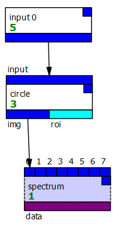

# Using PCOT as a library
As well as being a stand-alone application,
PCOT can be used as a library by other Python programs. This page discusses
three ways to do this, although the various elements can be easily blended
in a single program:

* Loading a PCOT document, reading some data and passing it through
the document's graph;
* Building a PCOT document programmatically and passing data through it;
* Using PCOT functions and data types without a graph.

While the latter two techniques can be useful
for quick ad-hoc work, on the whole we feel it is better to exchange
PCOT documents for traceability and clarity.


## Loading and running PCOT documents

A typical example might be a script
to read a PCOT document and run some data through that document's graph.
You could do that like this:

```python
# This example opens a graph, process some ENVI files through that graph,
# and saves them back to an ENVI. It assumes the graph has an "input 0" node
# which receives an image and a "sink" node which receives the processed
# image.

import pcot
from pcot.document import Document
from pcot.datum import Datum
from pcot.dataformats.envi import write

# initialise PCOT
pcot.setup()

# load the document
doc = Document("1.pcot")

# run the graph for some ENVI files. We'll just do one here, the ENVI
# document contained in the files 1.hdr and 1.dat (an ENVI document
# consists of two files: header and data).

for file in ("1",):

    # load the given ENVI file into input 0. To apply the header's data gain
    # and offset values, add apply_gains_and_offsets=True (they are not
    # applied by default, and the setting is kept if you don't give it).
    rv = doc.setInputENVI(0, file+".hdr")
    if rv is not None:
        raise Exception(f"{rv}")

    # run the document's graph 
    doc.run()

    # get the "sink" node
    outNode = doc.getNodeByName("sink")
    
    # get its output
    img = outNode.out.get(Datum.IMG)
 
    # write to new ENVI, e.g. 1b.hdr
    write(file+"b",img)
```

## Building a PCOT document

It's also possible to build a PCOT document, creating nodes within its graph.
Consider the graph



This could be built and run for a particular file with the following code:

```python
#!/usr/bin/env python

import pcot
import pcot.document
from pcot.datum import Datum

pcot.setup()

doc = pcot.document.Document()

# setInputENVI returns None on success, or an error message
result = doc.setInputENVI(0, "/home/white/PCOT/fff.hdr")
assert result is None, result

# create a document with just an input node in it, to bring that input into the document's graph
innode = doc.graph.create("input 0")

# add a region of interest (ROI) node to the image
roinode = doc.graph.create("circle")
# set the circle to be centred at (32,32) with a radius of 3 pixels
roinode.roi.set(32,32,3)

# connect its first input to the input node's first output
# args: 
#   input on this node to connect
#   node to get connection from
#   index on that node to connect to.
roinode.connect(0,innode,0)     

# connect a node to the ROI node which takes the resulting image-with-ROI
# and plots the spectrum of that ROI

specnode = doc.graph.create("spectrum")
specnode.connect(0,roinode,0)

# run the document
doc.run()

# get the output of the spectrum node, which will be a Datum,
# and dereference the Datum, ensuring that the data is of the right type.
# The result will be a SpectrumSet object.
output = specnode.getOutput(0, Datum.SPECTRA)

# print the spectra as a CSV table.
print(output)
```

## Using PCOT functions and data types without a graph

Often it is much simpler to just use the underlying PCOT data types without a graph.
The operation described in the previous section is an example of this. We could
use the `dataformats.load` package to load the data directly and manipulate it:

```python
#!/usr/bin/env python

import pcot
from pcot.datum import Datum
from pcot.dataformats import load
from pcot.rois import ROICircle
from pcot.utils.spectrum import SpectrumSet

pcot.setup()

# load the ENVI file as a Datum object. Will raise an exception
# if there is a problem
datum = load.envi("/home/white/PCOT/fff.hdr")

# retrieve the image, ensuring it's an IMG datum
img = datum.get(Datum.IMG)

# add a region of interest (ROI) node to the image:
# a circle to be centred at (32,32) with a radius of 3 pixels
img.rois.append(ROICircle(32,32,3))

# construct a spectrum set from this image - this can create spectra
# for multiple sources and combine them. Here we are just using a single
# source - the image we are working with - and we're calling it "in."
ss = SpectrumSet.fromImages({"in": img})

# Print the results as a CSV table.
print(ss)

# The set acts as a dictionary of spectrum names to Spectrum objects. Each
# Spectrum has a value for each filter, which you can get by wavelength or
# filter name.
for name, spectrum in ss.items():
    for f in spectrum.filters():
        print(name, f.name, f.cwl, spectrum.get(f.cwl).v)
```

## Changing configuration settings

PCOT's [settings](../userguide/settings.md) are loaded from the user's configuration file
when PCOT is imported. A script can change them for itself by setting them directly. The main
settings are in `pcot.config.data`, and the layout of spectra tables (and the CSV made from them)
is in `SpectrumSet.Provider.config`:

```python
import pcot
from pcot.utils.spectrumdata import SpectrumSet

pcot.setup()

# numbers in tables and other output to three significant figures
pcot.config.data.sigfigs = 3
# where non-image data is saved by default
pcot.config.data.locations.saveddata = "/tmp/output"

# spectra tables with one row per wavelength, showing mean±sd, without sample counts
SpectrumSet.Provider.config.orientation = "wv_rows"
SpectrumSet.Provider.config.format = "combined"
SpectrumSet.Provider.config.sample_count = False
```

The settings and their allowed values are the same as in the settings dialog and the *Table settings...*
dialog; `pcot getconfig` lists the main settings and their current values.

These changes only affect the script that makes them. They are not saved unless the script calls
`pcot.config.save()` - and if it does, they will replace the user's own settings, including those
they use in the PCOT application. For the same reason, don't change the table settings with a table
provider's `setParams()` method, which saves them.

Most settings are read when they are used, so changes take effect straight away. There are exceptions:

* `locations.pluginpath` is used by `pcot.setup()` to load plugins, so it must be changed *before*
`pcot.setup()` is called.
* `qt_platform` and `loadfile` are only used by the PCOT application.

Plugins may add their own settings. See [The configuration system](config.md) for how the
configuration is organised, and for adding settings of your own.
